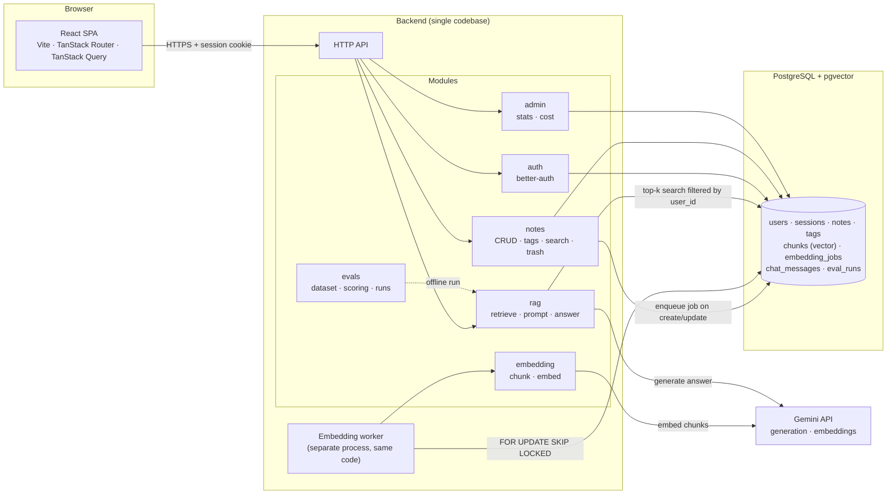
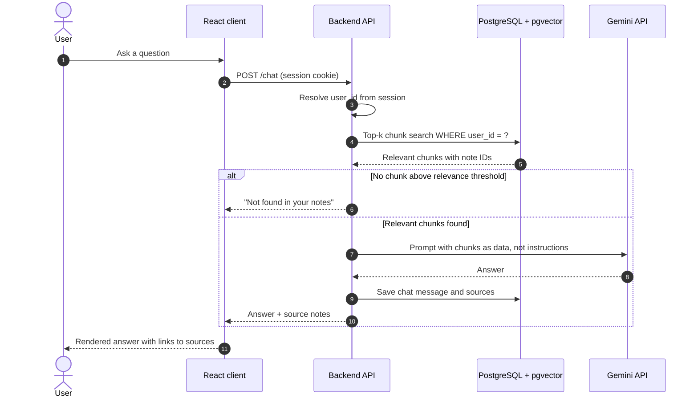
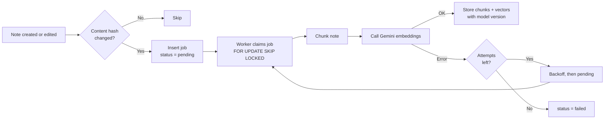

<a id="readme-top"></a>

<div align="center">

<h1>Synapse</h1>

<p>
  <b>A personal note-taking app with an AI assistant that answers questions from your own notes.</b>
</p>

<p>
  <a href="https://github.com/wynn-nguyen-dev/synapse/stargazers"></a>
  <a href="https://github.com/wynn-nguyen-dev/synapse/network/members"></a>
  <a href="https://github.com/wynn-nguyen-dev/synapse/issues"></a>
  <a href="https://github.com/wynn-nguyen-dev/synapse/commits/main"></a>
  <a href="https://github.com/wynn-nguyen-dev/synapse/blob/main/LICENSE"></a>
</p>

<p>
  
  
  
  
  
  
  
  
  
  
</p>

<p>
  <a href="https://github.com/wynn-nguyen-dev/synapse">
    <strong>Explore the docs »</strong>
  </a>
  <br />
  <br />
  <a href="https://synapse-demo.example.com">View Demo</a>
  ·
  <a href="https://github.com/wynn-nguyen-dev/synapse/issues/new?labels=bug">Report Bug</a>
  ·
  <a href="https://github.com/wynn-nguyen-dev/synapse/issues/new?labels=enhancement">Request Feature</a>
</p>

</div>

<details>
  <summary>Table of Contents</summary>
  <ol>
    <li><a href="#about-the-project">About The Project</a></li>
    <li><a href="#architecture">Architecture</a></li>
    <li><a href="#features">Features</a></li>
    <li><a href="#built-with">Built With</a></li>
    <li><a href="#getting-started">Getting Started</a>
      <ul>
        <li><a href="#prerequisites">Prerequisites</a></li>
        <li><a href="#installation">Installation</a></li>
      </ul>
    </li>
    <li><a href="#usage">Usage</a></li>
    <li><a href="#evaluation">Evaluation</a></li>
    <li><a href="#engineering-decisions">Engineering Decisions</a></li>
    <li><a href="#roadmap">Roadmap</a></li>
    <li><a href="#contributing">Contributing</a></li>
    <li><a href="#ai-usage">AI Usage</a></li>
    <li><a href="#license">License</a></li>
    <li><a href="#contact">Contact</a></li>
    <li><a href="#acknowledgments">Acknowledgments</a></li>
  </ol>
</details>

## About The Project

<!-- Add a screenshot of the chat page here -->
<!-- [![Synapse Screenshot][product-screenshot]](https://github.com/wynn-nguyen-dev/synapse) -->

Synapse lets you write notes and then ask questions about them. Instead of searching by keyword, you ask a question in plain language, and the assistant answers using only the notes you wrote, with links to the notes it used.

This project focuses on the parts that matter in production AI systems:

* **Grounded answers.** Responses come from your own notes. If the notes do not contain the answer, the assistant says so.
* **Measured retrieval quality.** A fixed evaluation set measures recall and answer faithfulness, and each change to chunking or retrieval is compared against a baseline.
* **Strict data isolation.** Every query, including vector search, is filtered by the authenticated user. Tests check that one user cannot read another user's notes or chunks.
* **Reliable background processing.** Embeddings are generated by a job queue stored in PostgreSQL, with idempotency, retries, and visible failure states.

<p align="right">(<a href="#readme-top">back to top</a>)</p>

## Architecture

Synapse is a single backend organized into modules, with a React single-page client and a background worker that share the same codebase and database.



**Request flow for a chat question:**



**Embedding flow:**



**Why one backend:** every request needs authentication, and modules share the same data. Splitting services at this scale adds network calls and deployment work without a matching benefit. The embedding worker is the only process split, because its workload differs from the API's.

<p align="right">(<a href="#readme-top">back to top</a>)</p>

## Features

* **Accounts:** sign up, sign in, sign out, password reset, and `user` / `admin` roles.
* **Notes:** create, edit, and delete notes in Markdown, with tags, tag filtering, keyword search, soft delete, and a trash view.
* **Semantic search:** find notes by meaning, shown separately from keyword search.
* **Chat with your notes:** ask questions and get answers with links to the source notes. Chat history is saved and can be deleted.
* **Background embedding:** notes are indexed asynchronously, with retries and a failed-jobs view for admins.
* **Evaluation suite:** a fixed question set, a single command to run it, and a results table comparing configurations.
* **Admin dashboard:** user and note counts, failed embedding jobs, and daily AI cost.
* **Observability:** structured logs with request IDs, and token, cost, and latency recorded for each model call.

<p align="right">(<a href="#readme-top">back to top</a>)</p>

## Built With

* **Frontend:** React, Vite, TanStack Router, TanStack Query, shadcn/ui, Tailwind CSS
* **Backend:** Node.js, TypeScript, better-auth
* **Database:** PostgreSQL with pgvector
* **AI:** Google Gemini API for generation and embeddings
* **Tooling:** Docker Compose, Vitest, k6

<p align="right">(<a href="#readme-top">back to top</a>)</p>

## Getting Started

Follow these steps to run Synapse locally.

### Prerequisites

* Node.js 20 or later
* pnpm
* Docker and Docker Compose
* A Google Gemini API key

### Installation

1. Clone the repository
```sh
   git clone https://github.com/wynn-nguyen-dev/synapse.git
   cd synapse
```
2. Copy the environment file and fill in your values
```sh
   cp .env.example .env
```
   Set `GEMINI_API_KEY`, `DATABASE_URL`, and `BETTER_AUTH_SECRET` in `.env`. Do not commit this file.
3. Start PostgreSQL with pgvector
```sh
   docker compose up -d db
```
4. Install dependencies and run migrations
```sh
   pnpm install
   pnpm db:migrate
```
5. Start the API, the embedding worker, and the web client
```sh
   pnpm dev
```
6. Open `http://localhost:5173` in your browser.

<p align="right">(<a href="#readme-top">back to top</a>)</p>

## Usage

1. Sign up and create a few notes. Each note is indexed in the background.
2. Open the **Search** page and try a semantic query, such as a question about a topic you wrote about without using the same words.
3. Open the **Chat** page and ask a question. Check the source links to confirm where the answer came from.
4. Ask something your notes do not cover. The assistant should say it could not find the answer.

<!-- Add screenshots here -->

<p align="right">(<a href="#readme-top">back to top</a>)</p>

## Evaluation

The evaluation suite measures retrieval and answer quality on a fixed set of notes and questions. The question set was written by hand, not generated by a model.

```sh
pnpm evals
```

| Configuration | Chunk size | Overlap | Top-k | Rerank | Recall@k | Faithfulness | p95 latency |
|---|---|---|---|---|---|---|---|
| Baseline | 512 | 0 | 5 | No | _TBD_ | _TBD_ | _TBD_ |
| Overlap | 512 | 64 | 5 | No | _TBD_ | _TBD_ | _TBD_ |
| Smaller chunks | 256 | 32 | 5 | No | _TBD_ | _TBD_ | _TBD_ |
| Rerank | 512 | 64 | 10 → 5 | Yes | _TBD_ | _TBD_ | _TBD_ |

Fill in the results after running the suite. Document what changed between runs and what it cost in latency and tokens.

<p align="right">(<a href="#readme-top">back to top</a>)</p>

## Engineering Decisions

Decisions are recorded in `docs/adr/`:

* [ADR-001: One backend instead of microservices](docs/adr/001-single-backend.md)
* [ADR-002: pgvector instead of a dedicated vector database](docs/adr/002-pgvector.md)
* [ADR-003: PostgreSQL as the job queue instead of a message broker](docs/adr/003-postgres-queue.md)
* [ADR-004: TanStack Router with Vite instead of TanStack Start](docs/adr/004-spa-over-ssr.md)
* [ADR-005: Scaling plan beyond the current scope](docs/adr/005-scaling-plan.md)

<p align="right">(<a href="#readme-top">back to top</a>)</p>

## Roadmap

- [x] Project setup and database migrations
- [x] Authentication with better-auth
- [ ] Note management with tags, search, and trash
- [ ] Background embedding pipeline
- [ ] Semantic search
- [ ] Chat with notes and source citations
- [ ] Evaluation suite with baseline and comparisons
- [ ] Data isolation tests and prompt injection tests
- [ ] Observability and rate limiting
- [ ] Admin dashboard
- [ ] Deployment and demo video

See the [open issues](https://github.com/wynn-nguyen-dev/synapse/issues) for the full list.

<p align="right">(<a href="#readme-top">back to top</a>)</p>

## Contributing

This is a personal project, but feedback and suggestions are welcome.

If you have an idea that would improve the project:

1. Fork the repository
2. Create a branch (`git checkout -b feature/your-idea`)
3. Commit your changes (`git commit -m "Add your idea"`)
4. Push to the branch (`git push origin feature/your-idea`)
5. Open a pull request

<p align="right">(<a href="#readme-top">back to top</a>)</p>

## AI Usage

AI tools were used during development for boilerplate, configuration, test scaffolding, and reviewing code. The architecture, data model, retrieval logic, data isolation rules, and evaluation dataset were designed and written by the author. Each AI-assisted change was read and tested before being merged.

<p align="right">(<a href="#readme-top">back to top</a>)</p>

## License

Distributed under the MIT License. See `LICENSE` for more information.

<p align="right">(<a href="#readme-top">back to top</a>)</p>

## Contact

Your Name: [@your_twitter](https://twitter.com/your_twitter)

Email: your.email@example.com

Project Link: [https://github.com/wynn-nguyen-dev/synapse](https://github.com/wynn-nguyen-dev/synapse)

<p align="right">(<a href="#readme-top">back to top</a>)</p>

## Acknowledgments

* [Best-README-Template](https://github.com/othneildrew/Best-README-Template)
* [better-auth](https://www.better-auth.com/)
* [TanStack](https://tanstack.com/)
* [pgvector](https://github.com/pgvector/pgvector)
* [Shields.io](https://shields.io/)
* [Mermaid](https://mermaid.js.org/)
