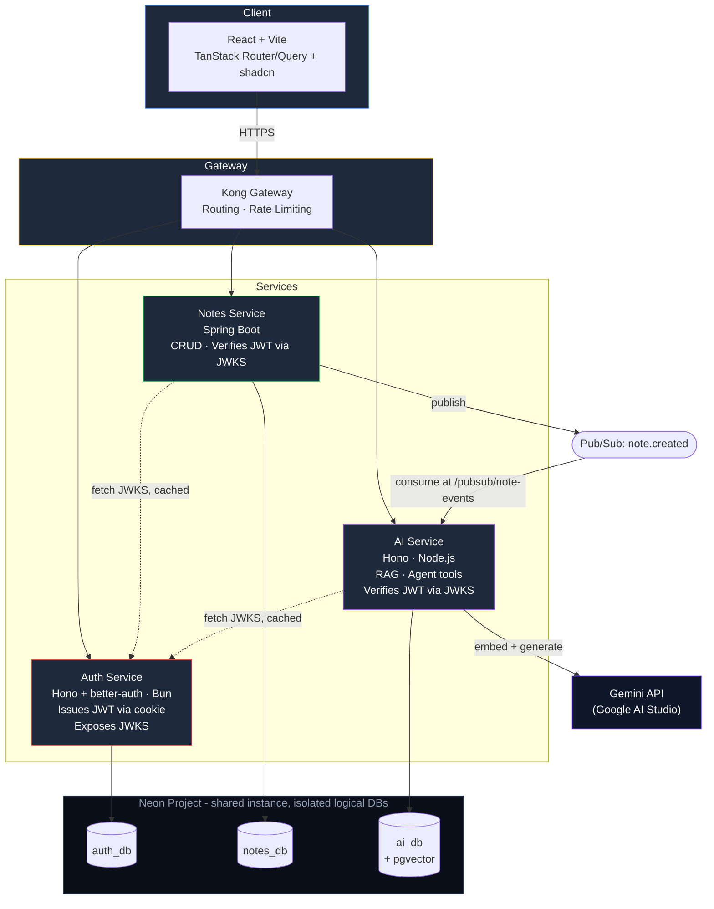

<a id="readme-top"></a>

<div align="center">

[![Contributors][contributors-shield]][contributors-url]
[![Forks][forks-shield]][forks-url]
[![Stargazers][stars-shield]][stars-url]
[![Issues][issues-shield]][issues-url]
[![MIT License][license-shield]][license-url]

[![Bun][bun-shield]][bun-url]
[![Node.js][node-shield]][node-url]
[![Hono][hono-shield]][hono-url]
[![Spring Boot][spring-shield]][spring-url]
[![React][react-shield]][react-url]
[![Vite][vite-shield]][vite-url]
[![TanStack Query][tanstack-shield]][tanstack-url]
[![Kong][kong-shield]][kong-url]
[![Neon][neon-shield]][neon-url]
[![pgvector][pgvector-shield]][pgvector-url]
[![Google Pub/Sub][pubsub-shield]][pubsub-url]
[![Cloud Run][cloudrun-shield]][cloudrun-url]

</div>

<br />
<div align="center">
  <h3 align="center">🧠 Synapse</h3>

  <p align="center">
    A personal notes app with an AI assistant that answers questions from your own notes (RAG) and can call tools to search notes, past chats, and the web.
    <br />
    <strong>Status: completed, no longer actively maintained.</strong>
    <br />
    <br />
    <a href="https://try-synapse-vault.vercel.app">View Demo</a>
    ·
    <a href="https://github.com/wynn-nguyen-dev/Synapse/issues/new?labels=bug&template=bug-report---.md">Report Bug</a>
    ·
    <a href="https://github.com/wynn-nguyen-dev/Synapse/issues/new?labels=enhancement&template=feature-request---.md">Request Feature</a>
  </p>
</div>

<details>
  <summary>Table of Contents</summary>
  <ol>
    <li>
      <a href="#about-the-project">About The Project</a>
      <ul>
        <li><a href="#built-with">Built With</a></li>
      </ul>
    </li>
    <li><a href="#architecture">Architecture</a></li>
    <li><a href="#ai-service-architecture">AI Service Architecture</a></li>
    <li>
      <a href="#getting-started">Getting Started</a>
      <ul>
        <li><a href="#prerequisites">Prerequisites</a></li>
        <li><a href="#installation">Installation</a></li>
      </ul>
    </li>
    <li><a href="#usage">Usage</a></li>
    <li><a href="#architecture-decision-records">Architecture Decision Records</a></li>
    <li><a href="#known-limitations">Known Limitations</a></li>
    <li><a href="#contributing">Contributing</a></li>
    <li><a href="#license">License</a></li>
    <li><a href="#contact">Contact</a></li>
    <li><a href="#acknowledgments">Acknowledgments</a></li>
  </ol>
</details>

## About The Project

<!-- Add 3-4 screenshots or a short demo video here: notes list, chat answer with sources, a question the notes cannot answer. -->

**Synapse** is a personal knowledge assistant that turns notes into a queryable knowledge base. Users create notes, the system generates embeddings in the background, and the AI service answers questions using RAG. It is a small polyglot microservices project with clear boundaries between product features, AI infrastructure, and asynchronous work: each service owns its own runtime, its own database, and its own reason for existing.

The core path:

```text
Login
  ↓
Create / manage notes
  ↓
Generate embeddings (async)
  ↓
Ask questions about personal notes
  ↓
Retrieve relevant notes (hybrid search)
  ↓
Generate a streamed, grounded AI answer
```

| Component | Stack | Responsibility |
|---|---|---|
| Auth | Hono + better-auth on **Bun** | Authentication and user identity, JWT issuance via cookie, JWKS exposure |
| Notes | **Java Spring Boot** | Note domain APIs + PostgreSQL persistence, JWT verification via JWKS |
| AI Service | Hono on **Node.js** | RAG, embeddings, streaming generation, agent tools, JWT verification via JWKS |
| Gateway | **Kong** | Edge routing and rate limiting |
| Client | React + Vite + TanStack Router/Query + shadcn | User interface |
| Database | **Neon (serverless PostgreSQL)** + **pgvector** | One logical database per service, shared Neon project |
| Async | **Google Cloud Pub/Sub** | Decoupled event delivery (`note.created`) |
| Deployment | **Google Cloud Run** | Serverless, scale-to-zero hosting for every service |

There is no RBAC layer: a valid JWT is enough to authorize a request, since every user only accesses their own data. This was a deliberate scope decision (see ADR-0005).

<p align="right">(<a href="#readme-top">back to top</a>)</p>

### Built With

* [![Bun][bun-shield]][bun-url]
* [![Node.js][node-shield]][node-url]
* [![Hono][hono-shield]][hono-url]
* [![Spring Boot][spring-shield]][spring-url]
* [![React][react-shield]][react-url]
* [![Vite][vite-shield]][vite-url]
* [![TanStack Query][tanstack-shield]][tanstack-url]
* [![Kong][kong-shield]][kong-url]
* [![Neon][neon-shield]][neon-url]
* [![pgvector][pgvector-shield]][pgvector-url]
* [![Google Pub/Sub][pubsub-shield]][pubsub-url]
* [![Cloud Run][cloudrun-shield]][cloudrun-url]

<p align="right">(<a href="#readme-top">back to top</a>)</p>

## Architecture

> Each service owns its own logical database. All three live inside a **single shared Neon project** as separate logical databases, not separate physical clusters.



### Architecture at a glance

| Layer | What it does |
|---|---|
| **Client** | Login, notes management, and chat UI |
| **Kong** | Single entry point; request routing and rate limiting (JWT verification happens downstream, not at Kong, see ADR-0002) |
| **Auth Service** | Owns authentication, issues JWT via HTTP-only cookie, exposes JWKS |
| **Notes Service** | Owns notes CRUD and the Notes database; verifies JWT via JWKS |
| **AI Service** | Owns retrieval, embeddings, generation, and agent tools; verifies JWT via JWKS |
| **Auth DB / Notes DB / AI DB** | Data owned by the matching service (the AI DB holds pgvector embeddings) |
| **Pub/Sub** | Async boundary for `note.created` |

**Request flow (RAG chat example):**

1. The client sends a request through **Kong**.
2. **AI Service** verifies the JWT locally using a JWKS public key cached from Auth.
3. The model decides whether to call tools. `searchNotes` runs hybrid retrieval (full-text + vector, fused with Reciprocal Rank Fusion) against the AI service's own database.
4. Retrieved notes are used as context for the answer.
5. The response is streamed back to the client.

**Async flow:**

```text
note.created
   ↓
Pub/Sub
   ↓
AI Service (/pubsub/note-events)
   ↓
AI DB / pgvector
```

<p align="right">(<a href="#readme-top">back to top</a>)</p>

## AI Service Architecture

The AI service separates **provider access** (keys and models) from **product features** (chat, titles, embeddings).

```text
chat / title / embeddings
    ↓
providers/ai-studio.ts   (getChatModel, getTitleModel, getEmbeddingModel)
    ↓
providers/router.ts      (pick(task) → healthy key + model)
    ↓
Google AI Studio (Gemini)
```

### Model and key failover

The router holds several API keys and an ordered fallback chain of models for each task (`chat`, `title`, `embed`). When a `(key, model)` pair hits a rate limit or quota error, it is put on a cooldown and the next healthy pair is used. This logic has a unit test in `services/ai/src/providers/router.test.ts`.

### RAG and embeddings

```text
note
  ↓
embedding (768 dimensions)
  ↓
AI DB / pgvector (HNSW index, cosine distance)
  ↓
hybrid retrieval (PostgreSQL full-text rank + vector, Reciprocal Rank Fusion)
  ↓
fallback to recent notes when nothing matches
  ↓
prompt context
  ↓
streamed answer
```

### Agent tools

The chat model can call three tools: `searchNotes`, `searchChatHistories`, and `searchWeb`, and decides which ones to use for each question.

### Authentication and JWKS

The AI service and Notes service both verify JWTs **independently**, without calling the Auth service on every request:

```text
request
  ↓
resource service (Notes or AI)
  ↓
JWKS cache
  ↓
local JWT signature verification
```

- The **AI service** uses `jose` with a module-level `createRemoteJWKSet()`.
- The **Notes service** uses Spring Security's OAuth2 Resource Server, following the same fetch-cache-verify model.

If the Auth service is briefly unavailable, Notes and AI keep verifying tokens signed with keys they already cached. A newly rotated signing key needs a successful JWKS refresh first.

<p align="right">(<a href="#readme-top">back to top</a>)</p>

## Getting Started

Synapse is designed to be runnable locally before any cloud deployment.

### Prerequisites

* [Bun](https://bun.sh/)
```sh
  curl -fsSL https://bun.sh/install | bash
```
* Node.js (LTS)
* Java 21+
* Docker & Docker Compose
* A Google AI Studio (Gemini) API key
* A [Neon](https://neon.tech/) project (optional, local PostgreSQL + pgvector is included in Docker Compose)

### Installation

1. Clone the repo
```sh
   git clone https://github.com/wynn-nguyen-dev/Synapse.git
   cd Synapse
```

2. Configure environment variables for each service
```sh
   cp services/ai/.env.example services/ai/.env
   # set the Gemini API key(s), database URL, JWKS URL, Pub/Sub settings
   # repeat for services/auth and services/notes where an example file exists
```

3. Start the backend stack (PostgreSQL + pgvector, Pub/Sub emulator, migrations, Auth, AI, Notes, Kong)
```sh
   docker compose up -d
```

4. Start the client
```sh
   cd client
   npm install
   npm run dev
```

Minimum smoke test:

```text
sign in
  → create a note
  → embedding generated (via Pub/Sub)
  → ask a question
  → retrieve the relevant note
  → receive a grounded AI answer
```

### Cloud deployment

The application was deployed to **Google Cloud Run** with **Neon** as the database and **Google Cloud Pub/Sub** for events, and the client on Vercel. Each Cloud Run service runs with `min-instances: 0` (scale-to-zero), trading occasional cold-start latency for near-zero idle cost. Deployment is a manual workflow in `.github/workflows/deploy-showcase.yaml`.

<p align="right">(<a href="#readme-top">back to top</a>)</p>

## Usage

1. Sign in and create a few notes.
2. Open the chat and ask a question that your notes can answer, ideally using different words than the note.
3. Ask something your notes do not cover and see how the assistant responds.
4. Ask a question that needs earlier conversation or the web to see the other tools.

<!-- Add screenshots here -->

<p align="right">(<a href="#readme-top">back to top</a>)</p>

## Architecture Decision Records

<details>
<summary><strong>ADR-0001: Runtime chosen per workload, not standardized</strong></summary>

**Status:** Accepted

**Context:** The system spans distinct workload types: a lightweight auth service, a data-heavy core domain, and an AI service dependent on a specific SDK ecosystem.

**Decision:** Auth runs on Bun; Notes runs on Java Spring Boot; the AI service runs on Node.js.

**Consequences:** Each service gets a runtime suited to it (fast cold-start vs. enterprise reliability vs. AI SDK maturity), at the cost of managing multiple build/tooling pipelines.

</details>

<details>
<summary><strong>ADR-0002: JWT verification at the resource service</strong></summary>

**Status:** Accepted

Notes and AI verify JWTs independently via a JWKS public key fetched from Auth and cached, instead of calling Auth on every request or verifying at Kong.

**Why:** Resource servers keep working during a temporary Auth outage as long as the signing key is already cached; services stay loosely coupled and language-agnostic in how they verify tokens.

**Trade-off:** Each service instance maintains its own JWKS cache, and a newly rotated key requires a successful refresh before it can be used. Verification logic is duplicated across Notes and AI rather than centralized at Kong.

</details>

<details>
<summary><strong>ADR-0003: Google Cloud Pub/Sub for async events</strong></summary>

**Status:** Accepted

**Context:** Synchronous embedding generation blocked the Notes service on the AI service's response, coupling note-creation latency to the Gemini API response time.

**Decision:** Use Google Cloud Pub/Sub for `note.created` events, since all services already run on Cloud Run and benefit from a managed, serverless-native messaging layer.

**Consequences:** No message broker to operate manually, at the cost of coupling to one cloud provider's messaging semantics. Retry and dead-letter handling were not built.

</details>

<details>
<summary><strong>ADR-0004: Neon + Cloud Run instead of self-managed Kubernetes</strong></summary>

**Status:** Accepted

**Context:** A full local Kubernetes setup (`kind`) was built and tested first: Dockerfiles, manifests, ConfigMaps, Kong-on-k8s routing, and DNS-based service discovery. Running that same setup on GKE 24/7 would incur real compute cost even when idle, disproportionate to the project's scale.

**Decision:** Deploy all services to Google Cloud Run (pay-per-request, scale-to-zero) with Neon as a serverless PostgreSQL provider.

**Consequences:** Near-zero idle cost and no cluster to maintain, at the cost of less fine-grained control over networking and scheduling. The `kind` setup remains in `infra/k8s` as a reference because it directly informed this decision.

</details>

<details>
<summary><strong>ADR-0005: No RBAC in current scope</strong></summary>

**Status:** Accepted

**Context:** The project's core value is the RAG and agent experience, not access control granularity, and every user only accesses their own notes.

**Decision:** Skip role-based access control; a valid JWT alone is sufficient to authorize a request.

**Consequences:** Simpler auth logic; revisiting RBAC would be a deliberate future decision rather than an oversight.

</details>

<details>
<summary><strong>ADR-0006: Kong as the single gateway across all services</strong></summary>

**Status:** Accepted

**Context:** With services written in different languages, a language-agnostic entry point avoids duplicating routing and rate-limiting logic per service.

**Decision:** Kong routes requests to all backend services; JWT verification itself happens downstream at each resource service (see ADR-0002), not at Kong.

**Consequences:** Centralized routing and a single base URL for the client; verification logic is duplicated across Notes and AI, accepted as a reasonable trade-off for service independence.

</details>

<p align="right">(<a href="#readme-top">back to top</a>)</p>

## Known Limitations

This project was completed as a case study and stopped before the following were done:

- **No evaluation suite.** Retrieval and answer quality were checked by hand, not measured.
- **Light test coverage.** Only the model router has a unit test.
- **No notification or reminder service.** The Pub/Sub design could support it, but it was never built.
- **No retry or dead-letter handling** for failed `note.created` events.
- **No RBAC**, by design (ADR-0005).
- Cold starts on Cloud Run make the first request after idle slow.

<p align="right">(<a href="#readme-top">back to top</a>)</p>

## Contributing

This project is no longer actively maintained, but feedback is welcome.

1. Fork the Project
2. Create your Feature Branch (`git checkout -b feature/AmazingFeature`)
3. Commit your Changes (`git commit -m 'Add some AmazingFeature'`)
4. Push to the Branch
5. Open a Pull Request

<p align="right">(<a href="#readme-top">back to top</a>)</p>

## License

Distributed under the MIT License. See `LICENSE` for more information.

<p align="right">(<a href="#readme-top">back to top</a>)</p>

## Contact

Nguyên (Wynn) - [@wynn-nguyen-dev](https://github.com/wynn-nguyen-dev)

Project Link: [https://github.com/wynn-nguyen-dev/Synapse](https://github.com/wynn-nguyen-dev/Synapse)

AI coding assistants were used during development. Architecture, service boundaries, and the retrieval design were decided by the author, and changes were read and tested before merging.

<p align="right">(<a href="#readme-top">back to top</a>)</p>

## Acknowledgments

* [Best-README-Template](https://github.com/othneildrew/Best-README-Template)
* [Vercel AI SDK](https://sdk.vercel.ai/)
* [pgvector](https://github.com/pgvector/pgvector)
* [Neon](https://neon.tech/)

<p align="right">(<a href="#readme-top">back to top</a>)</p>

<!-- MARKDOWN LINKS & IMAGES -->
[contributors-shield]: https://img.shields.io/github/contributors/wynn-nguyen-dev/Synapse.svg?style=for-the-badge
[contributors-url]: https://github.com/wynn-nguyen-dev/Synapse/graphs/contributors
[forks-shield]: https://img.shields.io/github/forks/wynn-nguyen-dev/Synapse.svg?style=for-the-badge
[forks-url]: https://github.com/wynn-nguyen-dev/Synapse/network/members
[stars-shield]: https://img.shields.io/github/stars/wynn-nguyen-dev/Synapse.svg?style=for-the-badge
[stars-url]: https://github.com/wynn-nguyen-dev/Synapse/stargazers
[issues-shield]: https://img.shields.io/github/issues/wynn-nguyen-dev/Synapse.svg?style=for-the-badge
[issues-url]: https://github.com/wynn-nguyen-dev/Synapse/issues
[license-shield]: https://img.shields.io/github/license/wynn-nguyen-dev/Synapse.svg?style=for-the-badge
[license-url]: https://github.com/wynn-nguyen-dev/Synapse/blob/main/LICENSE

[bun-shield]: https://img.shields.io/badge/Bun-000000?style=for-the-badge&logo=bun&logoColor=white
[bun-url]: https://bun.sh/
[node-shield]: https://img.shields.io/badge/Node.js-339933?style=for-the-badge&logo=nodedotjs&logoColor=white
[node-url]: https://nodejs.org/
[hono-shield]: https://img.shields.io/badge/Hono-E36002?style=for-the-badge&logo=hono&logoColor=white
[hono-url]: https://hono.dev/
[spring-shield]: https://img.shields.io/badge/Spring_Boot-6DB33F?style=for-the-badge&logo=springboot&logoColor=white
[spring-url]: https://spring.io/projects/spring-boot
[react-shield]: https://img.shields.io/badge/React-20232A?style=for-the-badge&logo=react&logoColor=61DAFB
[react-url]: https://react.dev/
[vite-shield]: https://img.shields.io/badge/Vite-646CFF?style=for-the-badge&logo=vite&logoColor=white
[vite-url]: https://vitejs.dev/
[tanstack-shield]: https://img.shields.io/badge/TanStack_Query-FF4154?style=for-the-badge&logo=reactquery&logoColor=white
[tanstack-url]: https://tanstack.com/query
[kong-shield]: https://img.shields.io/badge/Kong-003459?style=for-the-badge&logo=kong&logoColor=white
[kong-url]: https://konghq.com/
[neon-shield]: https://img.shields.io/badge/Neon-00E599?style=for-the-badge&logo=postgresql&logoColor=white
[neon-url]: https://neon.tech/
[pgvector-shield]: https://img.shields.io/badge/pgvector-4169E1?style=for-the-badge&logo=postgresql&logoColor=white
[pgvector-url]: https://github.com/pgvector/pgvector
[pubsub-shield]: https://img.shields.io/badge/Google%20Pub%2FSub-4285F4?style=for-the-badge&logo=googlecloud&logoColor=white
[pubsub-url]: https://cloud.google.com/pubsub
[cloudrun-shield]: https://img.shields.io/badge/Cloud%20Run-4285F4?style=for-the-badge&logo=googlecloud&logoColor=white
[cloudrun-url]: https://cloud.google.com/run
